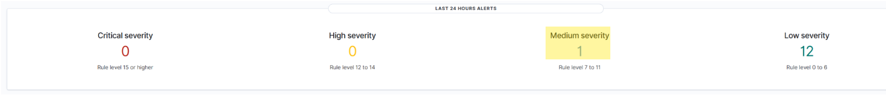
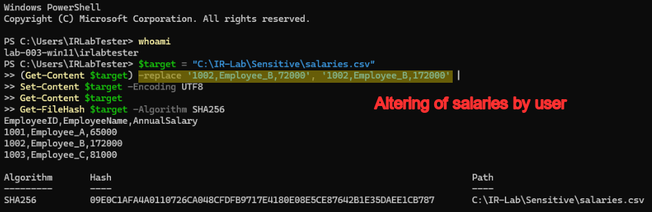
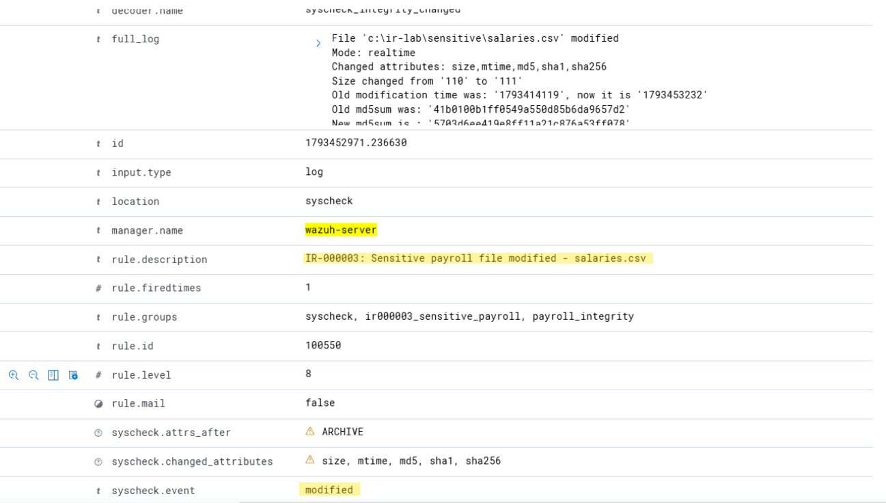
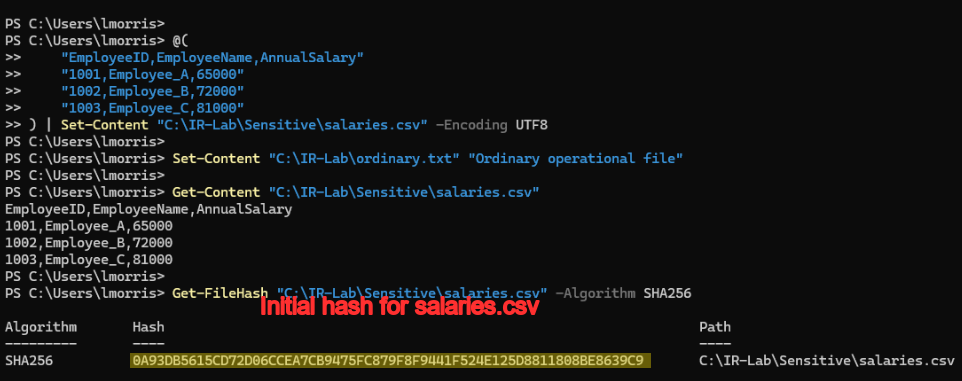
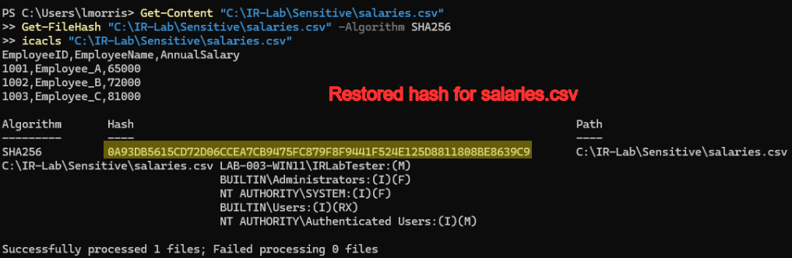
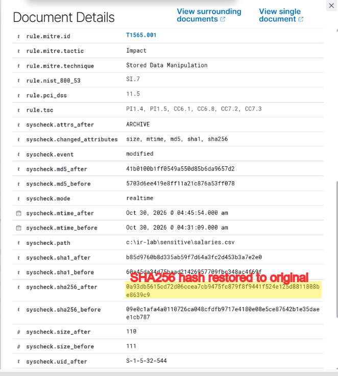
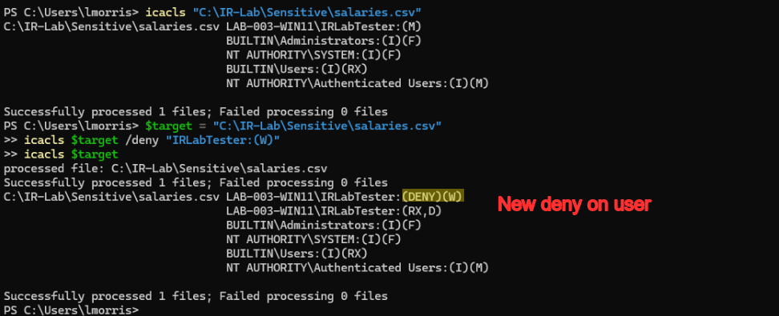
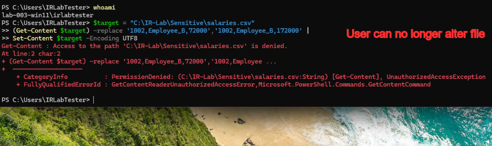

# Incident Report: IR-000003

**Case:** #3 - [SOC] IR-03 - Unauthorized File Modification  
**Client:**   
**Status:** Closed 

## 1. Case Identification

IR-03: Unauthorized File Modification

Luke Morris

## 2. Executive Summary

An unauthorized modification was made to a sensitive payroll file, `salaries.csv`, in which an employee's annual salary was increased from $72,000 to $172,000. The file was subsequently restored to its authorized contents, and additional access restrictions were implemented to prevent further unauthorized modifications.

The incident was first detected via a medium alert on Wazuh.

The affected asset was `C:\IR-Lab\Sensitive\salaries.csv` on the LAB-003 Windows 11 workstation. The modification was performed under the `IRLabTester` standard user account, while Wazuh and Splunk were used to investigate the associated file-integrity and system activity.

The modified payroll contents, changed SHA256 hash, and Wazuh FIM alert provide evidence that the file's integrity was compromised. Although the modification was associated with the `IRLabTester` account during the investigation, the available FIM evidence alone does not establish the user's intent or independently prove who initiated the change.

The incident compromised the integrity of sensitive payroll information by increasing an employee's recorded annual salary by $100,000. No evidence of payroll processing or financial disbursement was established, and the immediate integrity issue was addressed by restoring the authorized file and restricting write access.

The unauthorized payroll modification was investigated using Wazuh and Splunk, the available security evidence was reviewed, and the activity was contained by closing the associated PowerShell session. The original salary information was restored, and NTFS write restrictions were implemented. It was verified that a subsequent modification attempt was denied while the file's integrity remained intact.

It is recommended to review the affected account's access permissions, examining related authentication and PowerShell activity, and confirming that no additional records were modified. Reviewing file privacy levels is also advised.

## 3. Detection and Alert Details

The activity was detected on Wazuh and Splunk.

The alert signature was Wazuh FIM Rule 550, which identifies modifications to monitored files.

The affected endpoint was LAB-003-Windows11, and the account associated with the file modification was IRLabTester. The affected file was C:\IR-Lab\Sensitive\salaries.csv. No source or destination network addresses were identified as relevant to this file-integrity incident.

The Wazuh FIM evidence identified the affected file through the syscheck.path field, with the rule ID, event timestamp, and file-integrity information supporting the detection. The changed salary value and differing SHA256 hashes provided additional evidence that the file's contents had been modified from the authorized baseline.

The activity is consistent with MITRE ATT&CK T1565.001 (Stored Data Manipulation), under the Data Manipulation technique (T1565) and Impact tactic (TA0040).

## 4. Initial Triage

The investigation was prompted by the medium alert in Wazuh dashboard.

Initial checks to validate the event consisted of checking the alert on Wazuh and on Splunk to confirm the changing of hash value for the file.

Following initial triage, it is needed to determine whether the IRLabTester account had been compromised, whether the salary modification was an isolated incident, and whether other sensitive files had been accessed or altered. It was also needed to establish whether the modified payroll information had been used in any downstream financial processing or whether additional unauthorized activity had occurred.

## 5. Investigation Scope

The LAB-003 Windows 11 endpoint and the IRLabTester account associated with the unauthorized salary modification were investigated. The Wazuh File Integrity Monitoring alerts were examined, along with available Windows and PowerShell activity in Splunk, and the permissions and contents of C:\IR-Lab\Sensitive\salaries.csv.

The data sources and tools available were Wazuh, Splunk, Suricata, and Sysmon.

## 6. Evidence Collection

Screenshots were collected showcasing the incident, alerts notifying of it, and subsequent remediation, along with csv files of Wazuh results.

Evidence collected on Oct 30 by Luke Morris using Wazuh and Splunk.

Hashes were captured showing the change in file contents and the subsequent restoration of file contents.

## 7. Technical Analysis

PowerShell activity associated with the IRLabTester account was identified on the LAB-003 Windows 11 endpoint. The activity involved reading and modifying salaries.csv using PowerShell commands, including Get-Content and Set-Content, which resulted in an unauthorized increase to an employee's recorded annual salary.

Wazuh File Integrity Monitoring identified a modification to C:\IR-Lab\Sensitive\salaries.csv after Employee_B's annual salary was changed from $72,000 to $172,000. The file was subsequently restored to its authorized contents, and SHA256 hash comparisons were used to verify the integrity of the restored data. No deletion of the payroll file was identified.

The investigation centered on unauthorized local file modification rather than network-based activity. No suspicious network connections, DNS queries, or data exfiltration were established from the evidence reviewed, and no network-based indicators were identified as contributing to the incident.

The modification was performed under the IRLabTester standard user account, which initially possessed Modify permissions on the affected payroll file. The account's access rights were reviewed and a subsequent explicit NTFS Deny Write restriction was implemented, and confirmation was made that the same account could no longer modify the file. No privilege escalation was demonstrated during the investigation.

Wazuh provided the primary file-integrity detection, while Splunk was used to investigate available Windows and PowerShell activity associated with the affected endpoint. Findings, supporting evidence, remediation, and preventive actions in DFIR-IRIS were documented.

The affected file was C:\IR-Lab\Sensitive\salaries.csv on the LAB-003 Windows 11 endpoint, with activity associated with the IRLabTester account. SHA256 hash comparisons confirmed that the payroll file was modified and subsequently restored to its authorized contents. The primary indicator was the unauthorized salary increase from $72,000 to $172,000; no malicious IP addresses, domains, or network-based indicators were established during the investigation.

## 9. Findings and Root Cause

It is confirmed that the IRLabTester account modified the sensitive payroll file, increasing Employee_B's annual salary from $72,000 to $172,000. Wazuh File Integrity Monitoring detected the modification, and SHA256 hash comparisons verified that the file was subsequently restored to its original contents. It is also confirmed that implementing an NTFS Deny Write restriction prevented the account from repeating the modification.

The most likely initial cause was excessive file access permissions assigned to the IRLabTester standard user account. The account already possessed Modify access to the sensitive payroll file, allowing the unauthorized change through PowerShell without exploiting a software vulnerability or obtaining elevated privileges. No external intrusion or separate initial access mechanism was established.

Insufficient access restrictions were identified on the sensitive payroll file, which allowed a standard user account to modify financial records without administrative authorization. Although Wazuh detected the integrity violation, monitoring alone did not prevent the modification. Applying an explicit NTFS Deny Write restriction addressed the demonstrated access-control weakness for the affected account.

## 10. Containment and Remediation

The activity was contained by closing the PowerShell session associated with the unauthorized payroll modification, preventing further commands from being executed through that session. Subsequent restriction to the IRLabTester account's write access to the affected file prevents additional unauthorized modifications from them.

Remediation affected the LAB-003 Windows 11 endpoint, the IRLabTester account's permissions, and the sensitive payroll file at C:\IR-Lab\Sensitive\salaries.csv. The associated PowerShell session was closed, the modified salary information was restored, and write access was restricted for the affected account. No network connections or additional hosts required remediation.

The NTFS access-control configuration of salaries.csv was modified by applying an explicit Deny Write permission to the IRLabTester account. Wazuh File Integrity Monitoring was configured to monitor the sensitive payroll directory, with a dedicated Level 8 detection rule for salary-file modifications. No password changes, software patches, or firewall modifications were performed as part of remediation.

Successful remediation has been verified by confirming that the payroll file contained the original authorized salary values and that its SHA256 hash matched the recorded baseline. Modification attempt was repeated using IRLabTester, who received an access-denied error, confirming that the NTFS restriction prevented the account from modifying the file. Wazuh FIM evidence also documented the restoration of the monitored file.

## 11. Recovery and Validation

The salaries file was restored to the baseline and confirmed with a hash.

## 12. Conclusion and Recommendations

The incident is classified as a confirmed unauthorized file modification with a final severity of Medium. The investigation established that sensitive payroll information was altered using an account with excessive write permissions. The affected file was restored, its integrity was verified, and the same account was prevented from repeating the modification. Based on these findings, it is determined that the incident was contained and remediated.

The IRLabTester account modified a sensitive payroll file, increasing an employee's recorded annual salary by $100,000. Wazuh detected the file-integrity change, and subsequent remediation restored the original information. NTFS access restrictions successfully blocked a repeated modification attempt, demonstrating that the identified access-control weakness had been addressed for the affected account.

The highest priority corrective actions are a review of write permissions on all sensitive payroll files and removing unnecessary modification rights from standard user accounts. Additional priorities include validating the integrity of related financial records, reviewing account activity for unauthorized changes, and ensuring that access to payroll information follows the principle of least privilege.

It is recommended to maintain targeted Wazuh File Integrity Monitoring on sensitive payroll directories, with dedicated Medium-or-higher alerts for unauthorized modifications. It is also recommended to enable appropriate PowerShell script-block logging, improving correlation between Wazuh and Splunk, and establishing alert-review procedures that distinguish authorized administrative changes from suspicious activity.

## Classification

| Field | Value |
| --- | --- |
| IRIS Case ID | IR-000003 |
| Wazuh Alert ID | 1294787994.62290 |
| Wazuh Rule ID | 550 |
| Original Wazuh Rule Level | 8 |
| Affected Host | LAB-03-Windows11 |

## Timeline

| Time (UTC / source timezone) | Event |
| --- | --- |
|  |  |
| Oct 30, 2026 @ 04:31:14.955 am | Integrity checksum changed. |

## Evidence

| Tool | Field | Value |
| --- | --- | --- |
| test |  |  |
| Wazuh | agent.name | LAB-003-Windows11 |
| Wazuh | rule.description | Integrity checksum changed. |
| Wazuh | rule.id | 550 |
| Wazuh | rule.level | 7 |
| Wazuh | timestamp | Oct 30, 2026 @ 04:31:14.955 am |
