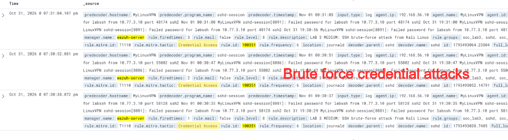
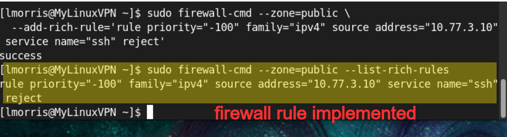
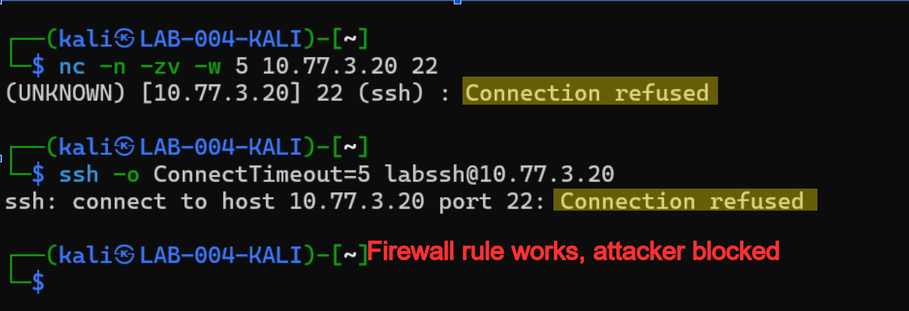
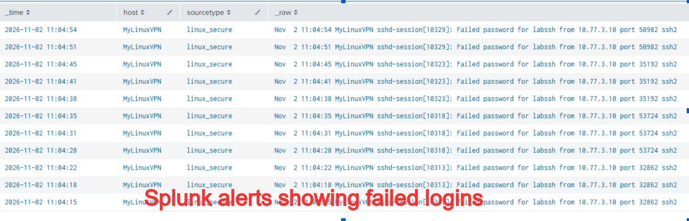
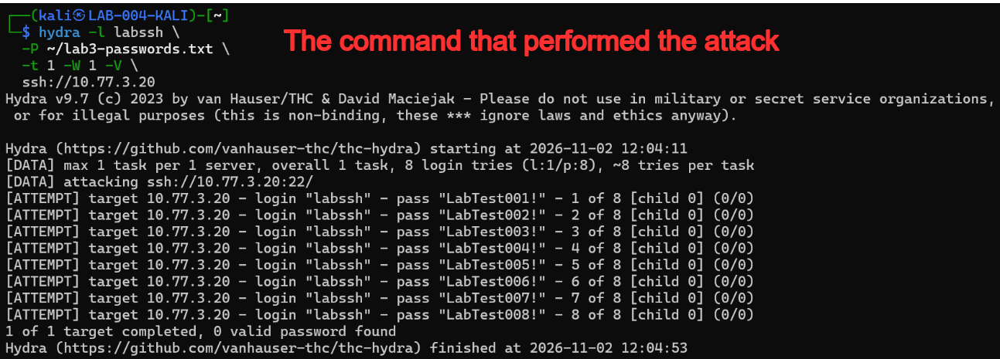
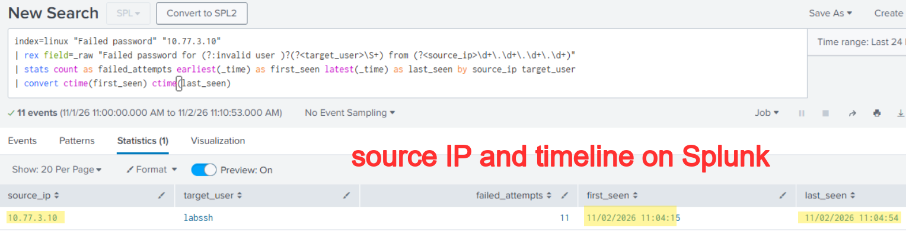

# Incident Report: IR-000005

**Case:** #5 - [SOC] IR-04 - Brute Force Attack  
**Client:**   
**Status:** Closed  

## 1. Case Identification

IR-04 - Brute Force Attack

Luke Morris

11/2/2026

## 2. Executive Summary

An external system at IP address 10.77.3.10 made repeated unsuccessful SSH login attempts against the labssh account on the CentOS server. The activity was consistent with a brute-force attack intended to gain unauthorized access through repeated password attempts.

The incident was initially detected by Wazuh, which generated a Medium-severity (Level 8) alert after identifying six failed SSH authentication attempts within 120 seconds. The alert triggered detection rule 100351, indicating a potential brute-force attack against the server.

The affected system was the CentOS server MyLinuxVPN (10.77.3.20), specifically its SSH service and the labssh user account. The authentication attempts originated from IP address 10.77.3.10, which was identified as the source of the suspicious activity.

Wazuh alerts and SSH authentication logs confirmed repeated failed login attempts from 10.77.3.10 targeting the labssh account. Although the activity was consistent with a brute-force attack, the available evidence must be reviewed for successful authentication or other unauthorized activity before determining whether the account was compromised.

The failed SSH authentication attempts were investigated using Wazuh and Splunk, then an appropiate firewall rule was implemented on the CentOS server to block SSH connections from 10.77.3.10. Subsequent testing confirmed the source could no longer establish an SSH connection, while legitimate administrative access remained available.

It is recommended to maintain the source IP restriction, reviewing SSH authentication logs for additional suspicious activity, and implementing account lockout or rate-limiting protections. SSH key-based authentication should also be considered to reduce the risk of future password-based attacks.

## 3. Detection and Alert Details

Wazuh initially detected the suspicious SSH authentication activity and generated a Medium-severity security alert. Splunk was subsequently used to investigate the authentication logs and corroborate the activity identified by Wazuh.

Wazuh generated alert 100351, titled "LAB 3 MEDIUM: SSH brute-force attack from Kali Linux," with a severity of Level 8 (Medium). The rule identifies six failed SSH authentication attempts within 120 seconds and maps the activity to MITRE ATT&CK technique T1110 (Brute Force).

## 4. Initial Triage

A Medium-severity alert generated by Wazuh indicated repeated failed SSH authentication attempts against the CentOS server. The frequency of the attempts suggested a potential brute-force attack, warranting investigation to determine whether unauthorized access had occurred.

The Wazuh alert details were examined to identify the source IP, targeted account, and authentication failures. Afterwards the SSH authentication logs were examined in Splunk to corroborate the activity and check for evidence of successful logins.

The activity was classified as suspicious and consistent with a brute-force attack because multiple unsuccessful login attempts originated from the same IP address within a short period. The repeated authentication failures justified containment, although the failed attempts alone did not establish that the account had been compromised.

## 5. Investigation Scope

The CentOS server MyLinuxVPN (10.77.3.20), the targeted labssh account, and SSH authentication activity originating from 10.77.3.10 were all investigated. Wazuh and Splunk were used to examine the authentication events and assess suspicious activity across the 10.77.3.0/24 network.

The CentOS server and its labssh account were confirmed targets of repeated SSH authentication attempts. The SSH service was affected by the activity, but no additional compromised systems or accounts were established by the available evidence.

## 6. Evidence Collection

Screenshots were collected showing the attack, alerts on Splunk and Wazuh, and application of the firewall rule that denies the attacker. Splunk csv files were collected as well to provide a timeline of events.

## 7. Technical Analysis

A process was executed that attempts several slightly different passwords on the labssh account.

No unauthorized file creation, modification, deletion, or file integrity violations were identified during the investigation. The observed activity involved repeated SSH authentication attempts rather than changes to files or system resources.

Multiple SSH connection attempts originated from 10.77.3.10 and targeted port 22 on the CentOS server at 10.77.3.20. The repeated connections and failed authentication attempts within a short period were consistent with brute-force activity, while no DNS-related anomalies were established.

The labssh account experienced repeated failed SSH authentication attempts originating from 10.77.3.10. The investigation focused on determining whether these attempts resulted in unauthorized access or privilege escalation, although neither was confirmed by the evidence reviewed.

Wazuh identified the repeated SSH authentication failures and generated a Medium-severity alert, while Splunk provided authentication logs for corroborating the source IP, targeted account, and sequence of events.

## 9. Findings and Root Cause

The primary finding is that multiple failed authentication events from 10.77.3.10 were made, suggesting a brute force attack.

The contributing control weakness was the lack of a limit on the number of authentication attempts, allowing for a brute force attack.

## 10. Containment and Remediation

A firewall rule was applied to block SSH connections to the attacker, preventing further password attempts.

After applying the firewall rule, the attacker could no longer establish an SSH connection through which they performed the attack, showing the remediation was successful.

## 12. Conclusion and Recommendations

The incident was classified as a confirmed SSH brute-force attempt with a final disposition of Contained. Wazuh and Splunk evidence supported the identification of repeated failed authentication attempts, and subsequent testing verified that the firewall restriction successfully blocked SSH access from the identified source IP while preserving legitimate administrative access.

The investigation confirmed repeated SSH authentication failures targeting the labssh account on the CentOS server from 10.77.3.10. The identified source was successfully blocked, and no unauthorized access or privilege escalation was established by the evidence reviewed.

The most important corrective action to take is to implement limited authentication attempts on all users to curb the risk of brute force attacks.

## Classification

| Field | Value |
| --- | --- |
| IRIS Case ID | IR-000005 |
| Wazuh Alert ID | 1793647404.62623 |
| Detection Timestamp | 2026-11-02T19:23:24.103+0000 |
| Wazuh Rule ID | 5758 |
| Original Wazuh Rule Level | 8 |
| Wazuh Rule Description | Maximum authentication attempts exceeded. |
| Affected Host | MyLinuxVPN |
| Agent ID | 001 |
| Agent IP | 192.168.56.10 |
| MITRE Technique | T1110 |

## Timeline

| Time (UTC / source timezone) | Event |
| --- | --- |
| 2026-11-02T19:23:24.103+0000 | Maximum authentication attempts exceeded. |
| 2026-11-02T19:23:24.125+0000 | syslog: User missed the password more than one time |
| 2026-11-02T19:23:24.161+0000 | LAB 3 MEDIUM: SSH brute-force attack from Kali Linux |
| 2026-11-02T19:23:24.161+0000 | syslog: User missed the password more than one time |
| 2026-11-02T19:23:24.161+0000 | Maximum authentication attempts exceeded. |
| 2026-11-02T19:23:36.109+0000 | Maximum authentication attempts exceeded. |
| 2026-11-02T19:23:36.113+0000 | syslog: User missed the password more than one time |
| 2026-11-02T19:23:36.138+0000 | LAB 3 MEDIUM: SSH brute-force attack from Kali Linux |

## Evidence

| Tool | Field | Value |
| --- | --- | --- |
| Wazuh | full_log | Nov  2 13:23:22 MyLinuxVPN sshd-session[11192]: error: maximum authentication attempts exceeded for labssh from 10.77.3.10 port 57768 ssh2 [preauth] |
| Wazuh | full_log | Nov  2 13:23:22 MyLinuxVPN sshd-session[11192]: PAM 2 more authentication failures; logname= uid=0 euid=0 tty=ssh ruser= rhost=10.77.3.10  user=labssh |
| Wazuh | full_log | Nov 02 19:23:22 MyLinuxVPN sshd-session[11192]: Failed password for labssh from 10.77.3.10 port 57768 ssh2 |
| Wazuh | full_log | Nov 02 19:23:22 MyLinuxVPN sshd-session[11192]: PAM 2 more authentication failures; logname= uid=0 euid=0 tty=ssh ruser= rhost=10.77.3.10  user=labssh |
| Wazuh | full_log | Nov 02 19:23:22 MyLinuxVPN sshd-session[11192]: error: maximum authentication attempts exceeded for labssh from 10.77.3.10 port 57768 ssh2 [preauth] |
| Wazuh | full_log | Nov  2 13:23:35 MyLinuxVPN sshd-session[11197]: error: maximum authentication attempts exceeded for labssh from 10.77.3.10 port 33560 ssh2 [preauth] |
| Wazuh | full_log | Nov  2 13:23:35 MyLinuxVPN sshd-session[11197]: PAM 2 more authentication failures; logname= uid=0 euid=0 tty=ssh ruser= rhost=10.77.3.10  user=labssh |
| Wazuh | full_log | Nov 02 19:23:35 MyLinuxVPN sshd-session[11197]: Failed password for labssh from 10.77.3.10 port 33560 ssh2 |
